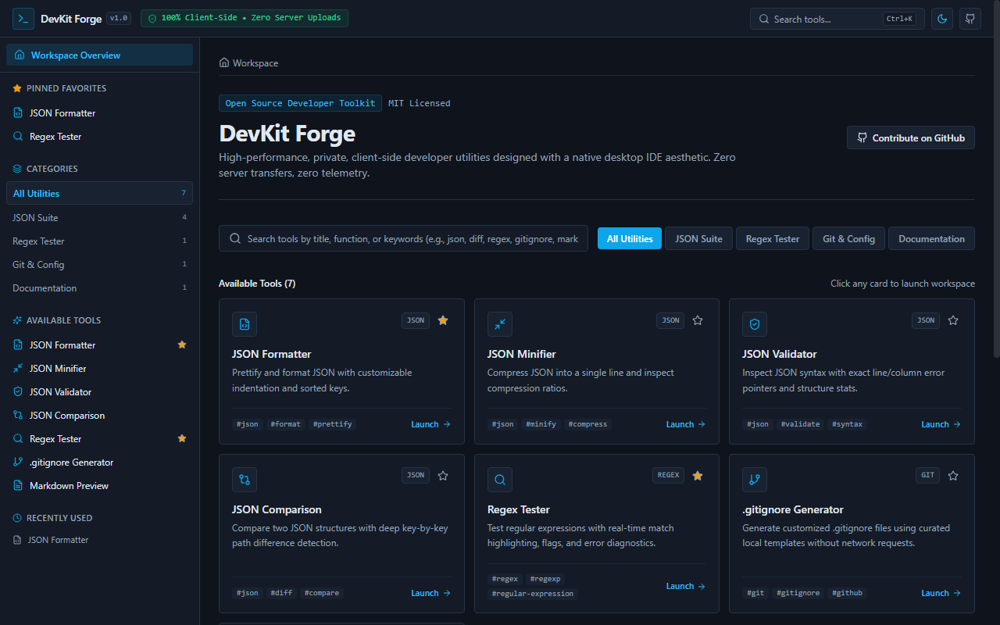
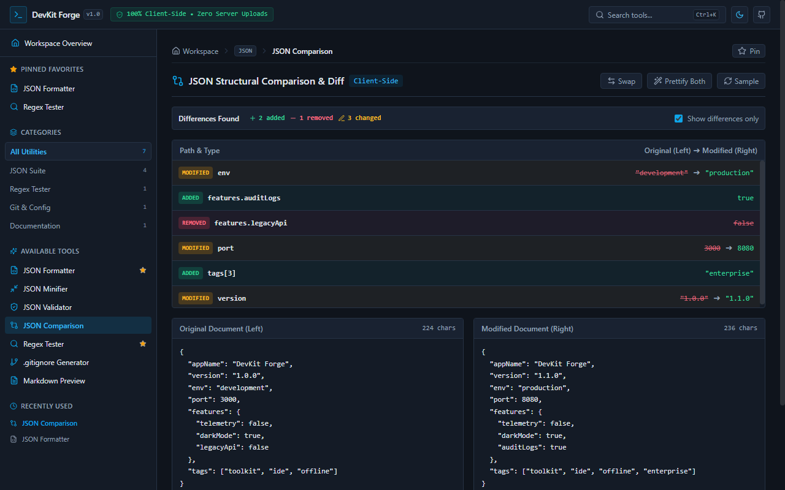
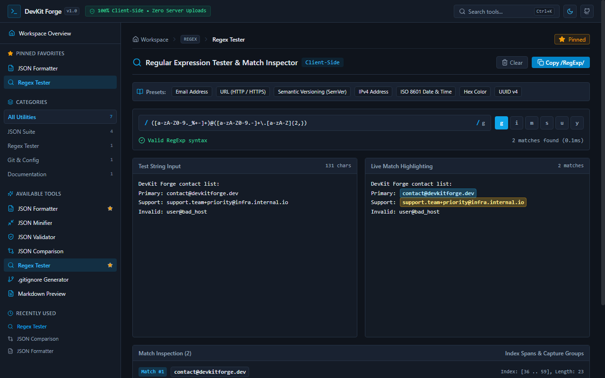
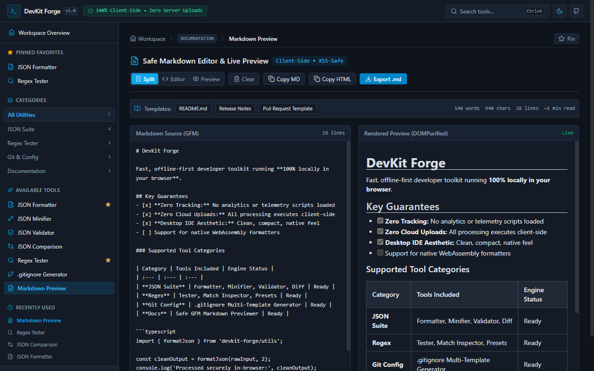

# DevKit Forge 🛠️

> **Fast, private, browser-native developer toolkit with a desktop IDE aesthetic.**  
> 100% Client-Side Processing • Zero Server Relays • Zero Telemetry • Zero Trackers

[](https://github.com/impreseo/DevKit-Forge/actions/workflows/ci.yml)
[](LICENSE)
[](https://www.typescriptlang.org/)
[](https://react.dev/)
[](https://vitejs.dev/)
[](https://tailwindcss.com/)
[](https://vitest.dev/)

---

### 🌐 Live Application Demo
**Try DevKit Forge directly in your browser:**  
👉 **[https://impreseo.github.io/DevKit-Forge/](https://impreseo.github.io/DevKit-Forge/)**

---

## 💡 Overview

Web-based developer utility sites are frequently overloaded with third-party tracking scripts, intrusive advertising banners, slow server roundtrips, and oversized marketing landing pages. Sending code snippets, tokens, configuration files, and data structures to third-party backends can also pose real data confidentiality risks.

**DevKit Forge** solves this with an open-source, client-side toolkit engineered for speed, utility, and privacy. Every data transformation, regular expression match, structural diff, and markdown render happens **entirely inside your browser's local memory**. No inputs are transmitted over the network.

---

## 📸 Application Preview

<p align="center">
  
</p>

| Tool | Genuine Application Preview |
| :--- | :--- |
| **JSON Structural Comparison**<br>Deep key-by-key path comparison showing added, removed, and modified properties with color-coded status badges and swap controls. |  |
| **Regex Tester & Inspector**<br>Worker-isolated evaluation with alternating match highlight badges, flags selector, and match index spans. |  |
| **Safe Markdown Preview**<br>Split-pane GitHub Flavored Markdown editor with DOMPurify sanitization, document metrics, and export controls. |  |

---

## ✨ Implemented Tools & Features

DevKit Forge currently includes **7 focused developer utilities**, organized into modular suites with a desktop IDE interface:

### 1. JSON Suite
* **JSON Formatter:** Prettify and format arbitrary JSON with configurable indentation (2 spaces, 4 spaces, or tabs) and optional alphabetical key sorting.
* **JSON Minifier:** Strip unneeded whitespace and compress JSON into a single line while reporting original bytes, minified bytes, bytes saved, and compression percentage.
* **JSON Validator:** RFC 8259 syntax checker with exact line and column pointers, error snippet excerpts, and structural metrics (key count, maximum nesting depth, and root data type).
* **JSON Comparison (Diff):** Deep recursive structural path-by-path comparison identifying additions, removals, and modifications with color-coded badges, side-by-side review, and swap controls.

### 2. Regular Expression Suite
* **Regex Tester:** Real-time pattern evaluation against test strings with alternating highlight badges.
* **Full Flag Support:** Toggle `g` (global), `i` (ignore case), `m` (multiline), `s` (dotAll), `u` (unicode), `v` (unicodeSets), and `y` (sticky).
* **Match & Capture Group Inspector:** Detailed breakdown of match index spans, match lengths, and named/numbered capture groups.
* **Worker-Isolated Execution:** Pattern evaluation runs in a dedicated, terminable Web Worker with a 500 ms safety timeout to protect the UI thread from catastrophic backtracking (ReDoS).
* **Curated Pattern Presets:** Quick-load test patterns for Email, URL, SemVer, IPv4, ISO 8601 timestamps, Hex colors, and UUID v4.

### 3. Git Utilities
* **.gitignore Generator:** 15+ curated local templates across Languages (Node.js, Python, Rust, Go, Java, C/C++), Frameworks (React/Vite, Next.js, Flutter), Operating Systems (macOS, Windows, Linux), and Editors (VS Code, JetBrains, Vim).
* **Zero-Network Generation:** Templates are compiled directly into the client bundle—no external GitHub API calls or internet connection required.
* **Custom Rules & Export:** Filter templates by category, toggle multiple tags, append project-specific rules, and copy to clipboard or download directly as a `.gitignore` file.

### 4. Documentation Suite
* **Markdown Preview:** Safe GitHub Flavored Markdown (GFM) editor with live preview supporting tables, task lists (`- [x]`), inline code, fenced code blocks, and blockquotes.
* **Flexible Layouts:** Switch seamlessly between split editor/preview, editor-only, and preview-only modes.
* **XSS Sanitization:** Rendered HTML is parsed via `marked` and sanitized with `DOMPurify` to ensure arbitrary script injections cannot execute.
* **Live Metrics & Export:** Real-time character, word, and line counters, estimated reading time, copy rendered HTML, and direct `.md` file download.

### 5. Desktop IDE Interface & Ergonomics
* **Command Palette (`Ctrl+K` or `⌘K`):** Global keyboard shortcut opening a searchable modal with instant fuzzy search across all tools, descriptions, and tags.
* **Favorites & Recent Tools:** Pin frequently used tools to the navigation bar and access your recent tool history.
* **Theme Support:** Switch between Dark mode (default), Light mode, and OS System preference.
* **Responsive Layout:** Desktop sidebar navigation with an accessible mobile drawer for smaller screens.

---

## 🔒 Privacy, Security & Storage Model

DevKit Forge enforces a strict local-first model verified directly against the source code:

| Dimension | Architectural Behavior | Verified Source |
| :--- | :--- | :--- |
| **Network Requests** | **Zero outbound requests.** The app issues zero `fetch()`, `XMLHttpRequest`, or `sendBeacon` calls. No backend servers, relays, or API proxies exist. | `src/` tree analysis |
| **Telemetry & Trackers** | **Zero trackers.** No Google Analytics, telemetry packages, marketing tags, or tracking cookies are included. | `package.json`, `index.html` |
| **Font & Asset Privacy** | **Local system fonts only.** Typography resolves via native system stacks (`ui-monospace`, `monospace`, system sans-serif); no Google Fonts or external CDNs are contacted at runtime. | `tailwind.config.js` |
| **Persistent Storage** | **UI preferences only.** `localStorage` is used exclusively for three non-sensitive UI settings: `devkit_forge_favorites` (pinned IDs), `devkit_forge_recents` (last 8 IDs), and `devkit_forge_theme` (`dark`, `light`, `system`). | `src/utils/storage.ts` |
| **Data Retention** | **Zero disk persistence.** User payloads, tokens, code snippets, and JSON data are kept strictly in ephemeral React state in memory. Closing or refreshing the browser tab completely clears all input data. | `src/components/tools/*` |
| **Execution Sandboxing** | **Web Worker isolation.** Regex evaluations execute in a separate worker thread terminated automatically after 500 ms to prevent UI freezes. | `src/workers/regex.worker.ts` |
| **XSS Protection** | **Sanitized HTML.** Live Markdown rendering is filtered through `DOMPurify` before DOM insertion. | `src/components/tools/MarkdownPreview.tsx` |

---


## 🛠️ Technology Stack

| Layer | Technologies |
| :--- | :--- |
| **Core Framework** | [React 18.3](https://react.dev/), [TypeScript 5.7](https://www.typescriptlang.org/) |
| **Build & Dev Tooling** | [Vite 6.0](https://vitejs.dev/) |
| **Styling & Icons** | [Tailwind CSS 3.4](https://tailwindcss.com/), [PostCSS](https://postcss.org/), [Lucide React 0.468](https://lucide.dev/) |
| **Parsing & Sanitization** | [Marked 15.0](https://marked.js.org/) (GFM parser), [DOMPurify 3.2](https://github.com/cure53/DOMPurify) (XSS defense) |
| **Testing & Quality** | [Vitest 2.1](https://vitest.dev/), [@testing-library/react 16.1](https://testing-library.com/), [JSDOM 25.0](https://github.com/jsdom/jsdom), [ESLint 9.17](https://eslint.org/) |
| **Deployment** | [GitHub Actions](https://github.com/features/actions), [GitHub Pages](https://pages.github.com/) |

---

## 🚀 Getting Started Locally

### Prerequisites
* [Node.js](https://nodejs.org/) `20.x` or higher
* [npm](https://www.npmjs.com/) `10.x` or higher

### Installation & Local Development

```bash
# 1. Clone the repository
git clone https://github.com/impreseo/DevKit-Forge.git
cd DevKit-Forge

# 2. Install dependencies cleanly from package-lock.json
npm ci

# 3. Start local Vite development server
npm run dev
```

Open your browser to `http://localhost:5173` to explore the workspace.

---

## 🧪 Available Scripts

All scripts match the definitions in `package.json`:

| Script | Command | Purpose |
| :--- | :--- | :--- |
| **`npm run dev`** | `vite` | Starts the Vite development server with Hot Module Replacement (HMR). |
| **`npm run build`** | `tsc && vite build` | Runs the TypeScript compiler and builds the production bundle into `dist/`. |
| **`npm run preview`** | `vite preview` | Serves the production build locally for pre-deployment inspection. |
| **`npm run test`** | `vitest run` | Executes all Vitest unit and integration test suites once. |
| **`npm run test:watch`**| `vitest` | Runs Vitest in interactive watch mode for test-driven development. |
| **`npm run lint`** | `eslint . --max-warnings 0` | Lints all source and test files using ESLint Flat Config. |
| **`npm run typecheck`** | `tsc --noEmit` | Validates TypeScript types across the entire project without emitting output. |

---

## 🌐 Deployment

Because DevKit Forge produces a 100% client-side static bundle, it can be hosted on any static web hosting provider:

### GitHub Pages (Automated via GitHub Actions)
The repository includes [.github/workflows/deploy-pages.yml](.github/workflows/deploy-pages.yml). On every push to `main`, GitHub Actions:
1. Runs `npm ci`, `npm run typecheck`, `npm run lint`, and `npm run test`.
2. Builds the production bundle with `VITE_BASE_PATH: '/DevKit-Forge/'`.
3. Deploys the static `dist/` directory directly to GitHub Pages.

To verify GitHub Pages configuration:
* Ensure **Settings → Pages → Source** is set to **GitHub Actions**.

### Other Static Hosting Platforms
To deploy to platforms like Cloudflare Pages, Vercel, or Netlify:
* **Build command:** `npm run build`
* **Output directory:** `dist`
* **Root directory:** `./`
* **Environment variables:** Leave `VITE_BASE_PATH` unset (defaults to relative root `'./'`) unless your host serves the app from a custom subpath.

---

## 🤝 Contributing

We welcome community contributions, including new browser-native developer tools, UI polish, performance improvements, and documentation enhancements.

1. Review [CONTRIBUTING.md](CONTRIBUTING.md) for architectural guidelines and a guide on adding a tool to the modular registry.
2. Adhere to the [Code of Conduct](CODE_OF_CONDUCT.md).
3. Ensure all validation checks pass before opening a Pull Request:
   ```bash
   npm run typecheck && npm run lint && npm run test && npm run build
   ```

---

## 📌 Project Status

**Current Version:** `1.0.0` (Initial Release)  
DevKit Forge is actively maintained. Its core foundation and initial 7 utilities are stable and tested. Upcoming tools and milestone tracking are documented in [ROADMAP.md](ROADMAP.md).

---

## 📄 License & Governance

* **License:** [MIT License](LICENSE) © 2026 DevKit Forge Contributors.
* **Security Policy:** [SECURITY.md](SECURITY.md) — instructions for responsible vulnerability disclosure.
* **Code of Conduct:** [CODE_OF_CONDUCT.md](CODE_OF_CONDUCT.md) — Contributor Covenant standards.
* **Roadmap:** [ROADMAP.md](ROADMAP.md) — planned features and future vision.
* **Issue Tracker:** [GitHub Issues](https://github.com/impreseo/DevKit-Forge/issues) — bug reports and tool proposals.
